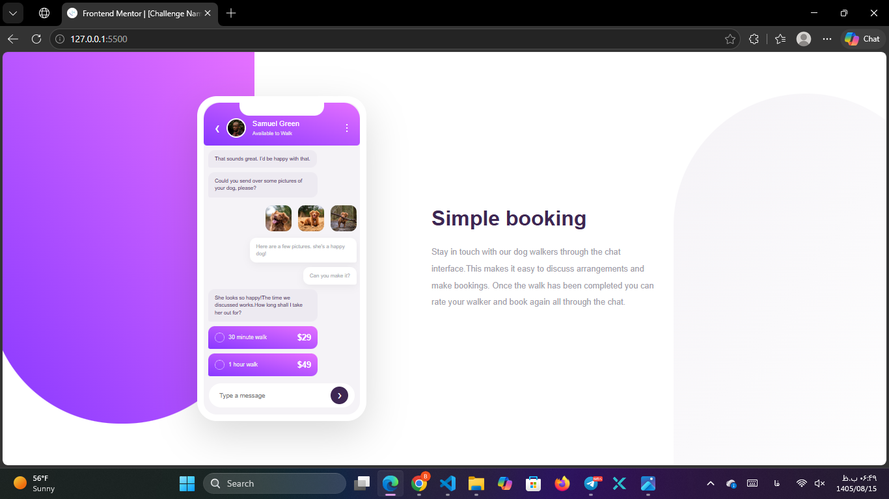

# Frontend Mentor - Chat App CSS Illustration solution

This is a solution to the [Chat App CSS Illustration challenge on Frontend Mentor](https://www.frontendmentor.io/challenges/chat-app-css-illustration-O5auMkFqY).

## Table of contents

- [Overview](#overview)
- [My process](#my-process)
- [Author](#author)

## Overview

### The challenge

Users should be able to:
- View the optimal layout for the site depending on their device's screen size
- See hover states for interactive elements (like the price buttons and the send button)

### Screenshot

 

### Links

- Solution URL: https://www.frontendmentor.io/solutions/chat-app-css-WcQ1UHlD47
- Live Site URL: https://baharkhezri.github.io/chat-app-css-illustration-master/
## My process

### Built with

- Semantic HTML5 markup
- CSS custom properties (Variables)
- Flexbox
- Mobile-first workflow
- CSS Pseudo-elements (`::before` and `::after`)

### What I learned

During this project, I faced some interesting challenges, especially with the background shapes and the layout inside the phone.

**1. Background Shapes (Pseudo-elements):**
Instead of using images, I used `::before` and `::after` on the `body` to create the purple and pale background curves. I learned how to use `position: absolute`, `border-radius` with different values for each corner, and `z-index: -1` to push them behind the content without causing horizontal scrolling.

**2. Flexbox & Layout:**
I used Flexbox for almost everything. From centering the `main` container on the screen, to arranging the messages inside the phone, to aligning the price and time inside the `.price-tag`. I also learned how to use `margin-left: auto` to push the price to the far right inside a flex container.

**3. Responsiveness (Handling the Send Bar):**
One of my biggest struggles was when switching to mobile view. The `send-bar` (input and send button) kept getting pushed outside the phone because of the fixed height. I solved this by using `margin-top: auto`, `flex-shrink: 0`, and changing the phone's height to `max-height: calc(100vh - 100px)` in the media query so it would fit perfectly in smaller screens.

**4. The Notch:**
Creating the notch at the top of the phone was tricky. I used `position: absolute`, `left: 50%`, and `transform: translateX(-50%)` to keep it perfectly centered, and made sure the parent (`.phone`) had `position: relative` so the notch wouldn't move when resizing the window.

### Continued development

In future projects, I want to get more comfortable with:
- Using CSS Grid for more complex layouts (maybe for the chat bubbles).
- Writing cleaner and more organized CSS (like using BEM methodology).
- Improving accessibility by adding more `aria-labels` and keyboard navigation.
- Animating the background shapes smoothly.

## Author

- Frontend Mentor - [@BaharKhezri](https://www.frontendmentor.io/profile/BaharKhezri)
- GitHub - [@BaharKhezri](https://github.com/BaharKhezri)
